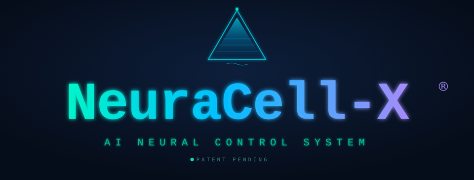

<p align="center">
  
</p>

> **Powered by NeuraCell-X® — the patent-pending AI Neural Control System.**
> Active radon protection and intelligent dew-point (Taupunkt) ventilation control.

# ioBroker adapter: Ambientika

ioBroker adapter for **Ambientika** ventilation units with heat recovery. It reads the
topics of the [Ambientika MQTT Bridge](https://github.com/ambientika-eu/ambientika-mqtt-bridge)
from your MQTT broker and shows every unit as an ioBroker device. Commands from ioBroker go
back to the units through the bridge.

Maintained by **Südwind GmbH**, the manufacturer of Ambientika. Works with bridge 1.6.34
and newer.

## How it works

```
Ambientika units ── Ambientika cloud ── Ambientika MQTT Bridge
                                              │  ambientika/<serial>/state
                                              ▼
                                         MQTT broker (Mosquitto or ioBroker.mqtt)
                                              │
                                              ▼
                                    ioBroker adapter "ambientika"
                                              │
                                     ambientika.0.<serial>.*
```

The adapter does not talk to the cloud itself. The bridge must be running (Home Assistant
add-on, Docker or Python) and publish to the same broker.

## Prerequisites

1. ioBroker with js-controller 5 or newer and Admin 6.13 or newer
2. A running [Ambientika MQTT Bridge](https://github.com/ambientika-eu/ambientika-mqtt-bridge)
3. An MQTT broker that both the bridge and ioBroker can reach (Mosquitto, or the
   `ioBroker.mqtt` adapter in server mode)

## Installation

The adapter is not yet in the ioBroker repository. Install it from the release package
(run on the ioBroker host):

```bash
cd /opt/iobroker
sudo -u iobroker npm install --omit=dev \
  https://github.com/ambientika-eu/ambientika-mqtt-bridge/releases/download/v1.6.34/iobroker.ambientika-1.6.34.tgz
sudo -u iobroker iobroker add ambientika
```

Then open the new instance `ambientika.0` in Admin and enter the broker settings.

To update, run the same two commands with the newer release package; `iobroker add` is
only needed once.

## Configuration

| Setting | Default | Description |
|---------|---------|-------------|
| MQTT broker host | `localhost` | Host name or IP of the broker |
| Port | `1883` | Broker port (usually 8883 with TLS) |
| User / Password | *(empty)* | Broker login, if required. The password is stored encrypted. |
| Use TLS | off | MQTT over TLS (`mqtts`) |
| Accept self-signed certificates | off | Only with TLS |
| Topic prefix of the bridge | `ambientika` | Must match `topic_prefix` of the bridge |
| Discovery prefix | `homeassistant` | The adapter reads the unit names from the bridge's discovery messages. Leave empty if the bridge does not publish discovery; the units are then named by serial number. |

`ambientika.0.info.connection` shows whether the adapter is connected to the broker.

## States

Every unit appears as `ambientika.0.<serial>` with the name it has in the Ambientika app.

### Read and write

| State | Values | Description |
|-------|--------|-------------|
| `operating_mode` | Smart, Auto, ManualHeatRecovery, Night, AwayHome, Surveillance, TimedExpulsion, Expulsion, Intake, MasterSlaveFlow, SlaveMasterFlow, Off | Operating mode. For paired units set the mode on the master. |
| `fan_speed` | Low, Medium, High | Fan speed. Night and Turbo are shown when the unit selects them itself (e.g. in Smart mode) but cannot be set. |
| `humidity_level` | Dry, Normal, Moist | Humidity setting |
| `light_sensor_level` | Off, Low, Medium | Sensitivity of the twilight sensor |
| `reset_filter` | button | Resets the filter counter (write `true`) |

### Read only

| State | Description |
|-------|-------------|
| `temperature`, `humidity` | Current reading of the unit |
| `temperature_avg`, `humidity_avg` | Averaged readings (see the bridge options `average_window_min` and following) |
| `humidity_raw` | Humidity as reported, also above 100 % |
| `air_quality` | Air quality (VeryGood, Good, Medium, Poor, Bad) |
| `filters_status`, `filters_status_raw` | Effective filter status and the unit's own value |
| `filter_ack_since`, `filter_ack_until` | Maintenance acknowledgement for slaves, if set |
| `humidity_alarm` | Humidity alarm of the unit |
| `night_alarm` | Night mode signal of the unit (twilight sensor) |
| `operating_mode_raw`, `last_operating_mode` | The unit's own mode and its last mode |
| `device_role`, `zone_index` | Master/slave role and zone |
| `online` | Unit reachable (from the bridge's availability topic) |
| `*_num` | Numeric companion values for charts |

### NeuraCell-X®

Under `ambientika.0.neuracell`, if the bridge runs radon or dew-point protection:
`radon_protection`, `radon`, `radon_threshold`, `radon_meter_connected`, `dewpoint_block`,
`dewpoint_controller_connected`, `dewpoint_fallback`, `indoor_dew_point`,
`outdoor_dew_point`, `override_active`. All read only.

## Example: ventilate the bathroom after a shower

```javascript
on({ id: 'ambientika.0.A0B1C2D3E401.humidity_avg', change: 'ne' }, obj => {
    if (obj.state.val > 75) {
        setState('ambientika.0.A0B1C2D3E401.fan_speed', 'High');
    }
});
```

## Troubleshooting

- **No units appear:** check that `info.connection` is true and that the bridge publishes
  `ambientika/<serial>/state` on the same broker (e.g. with MQTT Explorer). The topic prefix
  must be identical in bridge and adapter.
- **Units are named by serial number:** the names come from the bridge's discovery messages
  (bridge option `enable_discovery`, on by default) and the discovery prefix must match.
- **A command has no effect:** the bridge log shows every received command
  (`Command received: serial=… attr=…`).

## Related

- [Ambientika MQTT Bridge](https://github.com/ambientika-eu/ambientika-mqtt-bridge)
- [Home Assistant add-on](https://github.com/ambientika-eu/ambientika-ha-addon)
- [Homebridge plugin](../homebridge-plugin/) and [Matter bridge](../matter-bridge/)
- Support: info@ambientika.eu

## License

MIT License, © Südwind GmbH (SUEDWIND S.R.L.)

*NeuraCell-X® and PhaseCell-X® are registered trademarks. Patent pending.*
